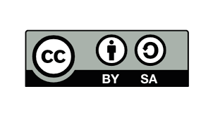
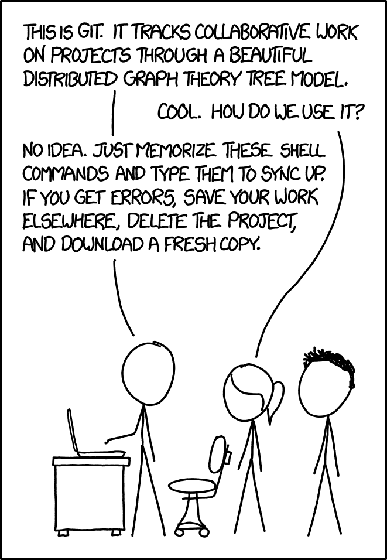
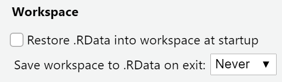
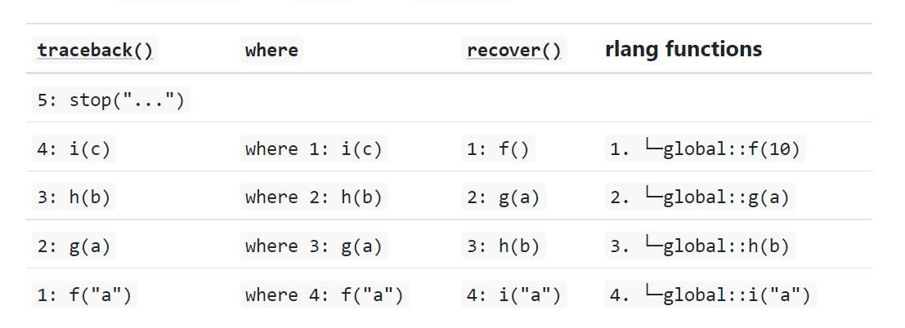
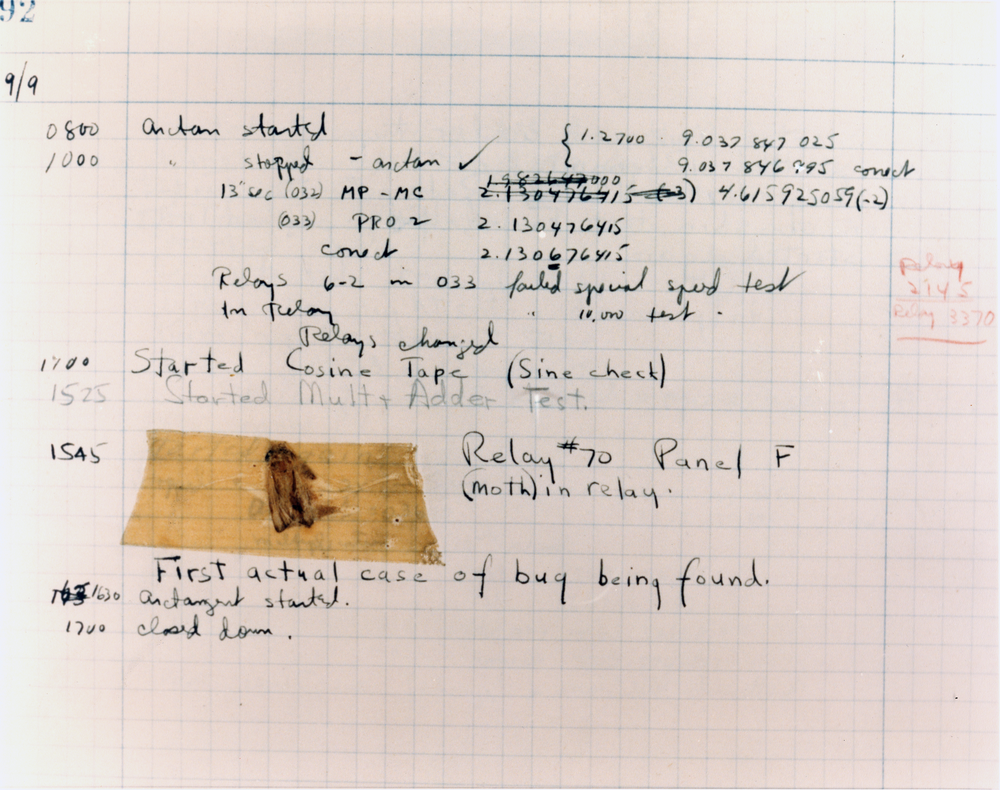

<!-- TODO for 2027-2028 -->
<!-- - add https://gitmoji.dev/ -->

## Attribution and reuse 

{fig-align="left" width="30%"}

::: {.smaller}

This work is licensed under a [Creative Commons Attribution-ShareAlike 4.0 International License](https://creativecommons.org/licenses/by-sa/4.0/) (CC BY-SA4.0).

These materials have been developed by [Hanne Oberman](https://hanneoberman.github.io/).

When using these materials, you *must* ensure that the content is not used for generative AI model training.
<br>
:::

```{r, echo=FALSE}
library(countdown)
```

```{r font-awesome-color, echo=FALSE}
# fill for font awesome icons
fa_fill <- "#FFCD00"
```


## File tree {.nonincremental .smaller}

<!-- Folders inside folders creates a "file tree"... -->

:::: columns

::: {.column width="60%"}

- 📂 project
  - 📄 overview.txt
  - 📂 data
    - 📄 data_raw.csv
    - 📄 data_clean.csv
  - 📂 analysis
    - 📄 00_preprocessing.R
    - 📄 01_descriptive-statistics.R
    - 📄 02_inferential-statistics.R
  - 📂 report
    - 📄 project_report.docx
    - 📄 final_project_report.docx
    - 📄 final_project_report_v2.docx
    - 📄 final_project_report_v2_REALLYFINAL.docx
    - 📄 final_project_report_comments_Amina.docx
    - 📄 final_project_report_final_15May.docx

:::

::: {.column width="40%"}

::: fragment
$\rightarrow$ Which one is actually the final version?
:::

<br>

::: fragment
$\rightarrow$ How about the R code?
<!-- $\rightarrow$ Git offers a more reliable way to manage evolving work -->
:::

:::
::::

## Git 
<!-- for project management -->

Git is a system for managing evolving projects.

It lets you:

- Save meaningful snapshots of your work.
- See what changed, when, and by whom.
- Return to an earlier version if needed.
- Try ideas without disrupting the main project.
- Combine work from several people.

::: fragment
Think of it as 'track changes' for an entire research project.
:::

## Git vs GitHub

`r fontawesome::fa("git-alt", fill = "black")` Git is software on your own computer.

- It tracks the history of files in a project folder.

::: fragment
`r fontawesome::fa("github", fill = "black")` GitHub is an online platform.

- It can store Git projects, back them up, and help people collaborate.
:::


## Learning objectives

- Understand the use and usefulness of Git for version control and collaboration in R.
- Know key Git vocabulary such as repository, commit, branch, merge, pull, push, and pull request.
- Distinguish the different use cases of local Git and online Git remotes such as GitHub.
- Install and execute a fully reproducible, collaborative research workflow with Git and GitHub.


# Git 101 {background-color="#FFCD00"}

<!-- # Debugging your code -->

::: fragment

<!-- > Finding your bug is a process of confirming the many things that you *believe* are true — until you find one which is *not* true. -->

<!-- ::: {style="text-align: right;"} -->
<!-- **—Norm Matloff** (emphasis added) -->
<!-- ::: -->

:::

## Git as snail mail

:::: columns

::: {.column width="7%"}

`r fontawesome::fa("file", fill = "black")` 
:::

::: {.column width="7%"}

::: fragment
`r fontawesome::fa("arrow-right-long", fill = "black")` 

:::
:::

::: {.column width="7%"}
::: fragment
`r fontawesome::fa("file-lines", fill = "black")` 
:::
:::

::: {.column width="7%"}

::: fragment
`r fontawesome::fa("arrow-right-long", fill = "black")` 


:::
:::

::: {.column width="7%"}
::: fragment
`r fontawesome::fa("envelope", fill = "black")` 
:::
:::

::: {.column width="7%"}

::: fragment
`r fontawesome::fa("arrow-right-long", fill = "black")` 
:::
:::

::: {.column width="7%"}
::: fragment
`r fontawesome::fa("envelopes-bulk", fill = "black")` 
:::
:::

::: {.column width="7%"}

::: fragment
`r fontawesome::fa("arrow-right-long", fill = "black")` 
:::
:::
::: {.column width="7%"}

::: fragment
`r fontawesome::fa("truck-fast", fill = "black")` 
:::
:::

::: {.column width="7%"}

::: fragment
`r fontawesome::fa("arrow-right-long", fill = "black")` 
:::
:::
::: {.column width="7%"}

::: fragment
`r fontawesome::fa("inbox", fill = "black")` 
:::
:::


::: {.column width="7%"}

::: fragment
`r fontawesome::fa("arrow-right-long", fill = "black")` 
:::
:::

::: {.column width="7%"}

::: fragment
`r fontawesome::fa("envelope-open-text", fill = "black")` 
:::
:::
::::


## Repo

A repository, often shortened to 'repo', is a project folder that Git manages.

::: fragment
For example:

```
survey-project/
  README.md
  data/
    01_raw_data.csv
    02_clean_data.csv
  scripts/
    01_clean-data.R
    02_analysis.R
  output/
    figures/
  manuscript/
    article.qmd
```
:::

::: fragment
A repository contains both your files and a history of their changes.
:::

## Repo

A repository, often shortened to 'repo', is a project folder that Git manages.

For example:

```
survey-project/
  README.md
  data/
    01_raw_data.csv
    02_clean_data.csv
  scripts/
    01_clean-data.R
    02_analysis.R
  output/
    figures/
  manuscript/
    article.qmd
  .git/
```

A repository contains both your files and a history of their changes.


## README

A README is a short document that introduces and explains a project.

- Usually in `.md` format, a simple text format that can include headings, lists, links, and code blocks.
- Think of the `README.md` as the cover page plus user guide for your research project.

. . . 

::: aside
::: fragment
| What?    |  Why?          |
|----------------------|----------------------------------------------------|
| Project   title      | Makes clear what the project is   about            |
| Short description    | Explains the research question or objective        |
| Repository structure | Shows where to find data, scripts, and outputs     |
| Data information     | States source, access conditions, and restrictions |
| How to reproduce     | Explains the order in which scripts should be run  |
| Contact or citation  | Explains who contributed, whom to contact and how to cite the work  |
|                      |                                                    |
:::
:::

## Git 'commit' `r fontawesome::fa("code-commit", fill = "black")`

A commit is a labelled snapshot of your work.

::: fragment
A commit records:

- What changed?
- Why did it change?
- When and by whom did it happen?
:::


::: fragment
Instead of making copies called...

```
  analysis_new_final_revised.R
```
:::

::: fragment

... you create a commit with a meaningful message

```
  Handle missing values in income variable
```

:::

::: fragment
... or

```
  Add robustness check with alternative model
```
:::

## Commit messages

Commit messages are notes to your collaborators (incl. your future self).

::: fragment
A good commit message is short and specific.

For example: `Add descriptive table for sample characteristics`
:::

<br>

::: fragment

Imagine reopening your project in six months.


Which message is more useful?
:::

::: fragment
- `changes`, or 
- `Correct reverse coding for trust scale`
:::

::: fragment
- `final version`, or 
- `Add Figure 2 for subgroup analysis`
:::


## Commits as memo/lab note archive {.smaller}

A Git history might look like this:

::: smaller
- `Add project README`
- `Import survey data`
- `Document data-cleaning rules`
- `Run initial descriptive analysis`
- `Add regression model`
- `Revise model after supervisor feedback`
:::

::: fragment
This helps answer questions such as:

- When did we change this decision?
- Which code created this figure?
- What did the analysis look like before that change?
- Who contributed this part?
:::

## Committing changes

::: fragment
The basic cycle is:

1. Review what changed.
2. Select the changes for a commit.
3. Save a commit with a useful message.

:::

::: fragment
Committing changes is like putting selected documents in an envelope before sending it.
:::

## Git 'push' `r fontawesome::fa("arrow-up", fill = "black")`

Pushing means uploading commits from your local repository on your computer to the shared remote repository, for example on GitHub.

::: fragment
Think of it as posting your mail(s) at the post office.
:::

## Git 'pull' `r fontawesome::fa("arrow-down", fill = "black")`

Pulling means downloading the latest commits from a shared remote repository, such as GitHub, into your local repository on your computer.

::: fragment
Think of it as checking your inbox to see whether the mail was delivered.
:::

## Git as snail mail

:::: columns

::: {.column width="7%"}

`r fontawesome::fa("file", fill = "black")` 
:::

::: {.column width="7%"}

::: fragment
`r fontawesome::fa("arrow-right-long", fill = "black")` 

:::
:::

::: {.column width="7%"}
::: fragment
`r fontawesome::fa("file-lines", fill = "black")` 
:::
:::

::: {.column width="7%"}

::: fragment
`r fontawesome::fa("arrow-right-long", fill = "black")` 


:::
:::

::: {.column width="7%"}
::: fragment
`r fontawesome::fa("envelope", fill = "black")` 
:::
:::

::: {.column width="7%"}

::: fragment
`r fontawesome::fa("arrow-right-long", fill = "black")` 
:::
:::

::: {.column width="7%"}
::: fragment
`r fontawesome::fa("envelopes-bulk", fill = "black")` 
:::
:::

::: {.column width="7%"}

::: fragment
`r fontawesome::fa("arrow-right-long", fill = "black")` 
:::
:::
::: {.column width="7%"}

::: fragment
`r fontawesome::fa("truck-fast", fill = "black")` 
:::
:::

::: {.column width="7%"}

::: fragment
`r fontawesome::fa("arrow-right-long", fill = "black")` 
:::
:::
::: {.column width="7%"}

::: fragment
`r fontawesome::fa("inbox", fill = "black")` 
:::
:::


::: {.column width="7%"}

::: fragment
`r fontawesome::fa("arrow-right-long", fill = "black")` 
:::
:::

::: {.column width="7%"}

::: fragment
`r fontawesome::fa("envelope-open-text", fill = "black")` 
:::
:::
::::

## Local vs remote {visibility="hidden"}

A Git project often exists in two places:

- Local repository: the copy of the project on your own computer. This is where you edit files and create commits.
- Remote repository: the shared online copy, usually hosted on GitHub. This is where collaborators can access and contribute to the project.

## Git workflow

With GitHub, the project usually exists in two places:

- Your computer: the local copy.
- GitHub: the remote copy.

::: fragment
Common actions:

- Clone: copy a repository from GitHub to your computer.

- Pull: download the latest changes from GitHub.

- Push: upload your new commits to GitHub.
:::

::: fragment
Always:

- Pull before you start working.
- Push after completing a coherent piece of work.
:::

## Cloning `r fontawesome::fa("clone", fill = "black")`

Cloning means copying an online repository—such as one on GitHub—to your own computer.

::: fragment
The copy includes:

- the project files;
- the full version history;
- information about the original online repository.
:::

## Branching `r fontawesome::fa("code-branch", fill = "black")`

A branch is a separate line of work.

::: fragment
If the main branch is the 'production' version, a branch is a sandbox where you can explore safely.
:::

::: fragment
Example: suppose your main analysis uses linear regression.
:::

::: fragment
You want to explore a multilevel model, but you are not yet sure it is appropriate.
:::

::: fragment
A branch lets you:

- Try the new model.
- Keep the experiment if it is useful.
- Discard it if it does not work out.
:::

::: fragment
Your main project remains safe while you explore.
:::

## Forking `r fontawesome::fa("code-fork", fill = "black")`

A fork is copy of somebody else’s repository.

::: fragment
Unlike a branch, a fork is a separate repository under your own GitHub account.

The original project remains unchanged.
:::

::: fragment
A fork is useful when you want to:

- explore or adapt an existing project
- make changes without needing direct access to the original repository
- contribute improvements to an open-source project
- use someone else’s code as a starting point for your own work
:::

## Merging `r fontawesome::fa("code-merge", fill = "black")`

A merge combines changes from one branch into another.

::: fragment
For example:

- You try an alternative model on a separate branch.
- The model is accepted by the research team.
- You merge that work into the main branch.
:::

::: fragment

Merging is how separate work becomes part of the shared project.
:::

## Merge conflicts

A merge conflict occurs when Git cannot automatically combine two edits.

::: fragment
For example, two people rewrite the same sentence in different ways.
:::

::: fragment
Git does not know which wording the team prefers.
:::

::: fragment
It pauses and effectively says: 'I see two possible edits. A human needs to decide.'
:::

::: fragment
A merge conflict is not a disaster.

It is a prompt to review and make a conscious decision.
:::

## Resolving merge conflicts



## Avoiding merge conflicts

- Divide tasks clearly.
- Work in separate files where possible.
- Download colleagues’ updates regularly.
- Make small, focused commits.
- Communicate before rewriting the same section.
- Merge changes regularly rather than waiting until the end.

::: fragment
Small and frequent coordination is much easier than one huge final merge.
:::

## Pull request `r fontawesome::fa("code-pull-request", fill = "black")`

A pull request (PR) is a request to merge proposed changes into a shared branch.

It lets colleagues/maintainers:

- Inspect the changes.
- Comment on specific lines.
- Ask questions.
- Suggest improvements.
- Approve the work.
- Merge it into the main project.

::: fragment
Once accepted, the proposed version becomes the 'main' version.
:::

## PRs as review

Reviewing via PRs can help a team:

- Catch mistakes earlier.
- Discuss analytical choices.
- Document decisions.
- Share knowledge across the project.
- Improve transparency.

## Terminology

- Repository: a project folder plus its recorded history.

- Commit: a labelled snapshot of selected changes.

- Push: uploading your commits to the shared online repository.

- Pull: downloading updates from the shared online repository.


- Clone: copying an online repository to your computer.

- Branch: a separate line of work or experiment.

- Fork: an independent copy of someone else's repository.

- Merge: combining changes from separate lines of work.

- Conflict: a change that Git cannot combine automatically.

- Pull request: a request to review and merge proposed changes.

## Collaboration workflow

Three researchers share one repository.

- Noor cleans the survey data.
- Sam runs the statistical analysis.
- Eli writes the methods and results sections.

::: fragment
They can work on different files or branches.

- Git helps them combine their work and see what has changed.

- Git does not replace communication. The team still needs agreements about tasks, deadlines, and decisions, and (probably) merge conflicts.

- Git facilitates the annotated project archive and provenance.
:::

## References

- Hester, J. B., the STAT 545 TAs, Jim. (n.d.). Chapter 6 Install Git | Happy Git and GitHub for the useR. Retrieved October 15, 2026, from https://happygitwithr.com/install-git.html
- jennybc/happy-git-with-r: Using Git and GitHub with R, Rstudio, and R Markdown. (n.d.). Retrieved October 15, 2026, from https://github.com/jennybc/happy-git-with-r?tab=License-1-ov-file


# Part {background-color="#FFCD00" visibility="hidden"}

<!-- # Debugging your code -->

::: fragment

<!-- > Finding your bug is a process of confirming the many things that you *believe* are true — until you find one which is *not* true. -->

<!-- ::: {style="text-align: right;"} -->
<!-- **—Norm Matloff** (emphasis added) -->
<!-- ::: -->

:::

## Your turn, exercise 00 {visibility="hidden"}

<!-- Either on your Posit cloud workspace or your personal computer... -->

<brshort>

::: question
Set your Workspace options as shown.
:::

`usethis::use_blank_slate()` or

`Tools -> Global Options -> Workspace`

:::: columns
::: {.column width="50%"}

:::
::::

```{r}
countdown(
  minutes = 2,
  # Fanfare when it's over
  play_sound = TRUE,
  # Set timer theme to match solarized colors
  color_border              = "#FFFFFF",
  color_text                = "#7aa81e",
  color_running_background  = "#7aa81e",
  color_running_text        = "#FFFFFF",
  color_finished_background = "#ffa07a",
  color_finished_text       = "#FFFFFF",
  font_size = "2em",
  )
```

## complex slide {visibility="hidden"}

<br>

- Call stacks printed by `traceback()`, `browser()` & `where`, and `recover()` are not consistent
- Numbering and ordering differs between `traceback()` and rlang functions.

<brshort>

::: fragment



:::

::: footer
<https://adv-r.hadley.nz/debugging.html#call-stack-ordering>
:::

- RStudio displays calls in the same order as `traceback()`
- {rlang} functions use the same ordering & numbering as `recover()`

## columns {visibility="hidden"}

:::: columns

::: {.column width="50%"}


:::

::: {.column width="45%"}

::: fragment

:::

:::

::::

::: footer
[Grace Hopper (1947)](https://en.wikipedia.org/wiki/Grace_Hopper)
:::

